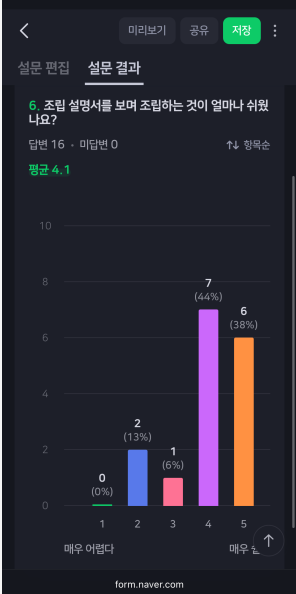
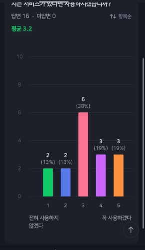
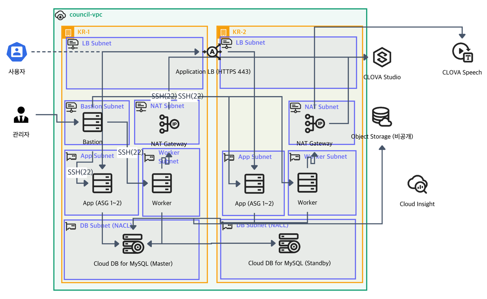
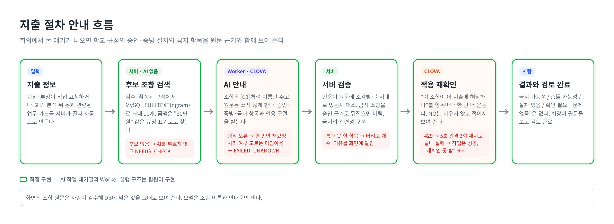

# part너 (student-council)

**회의 녹음에서 학생회 업무를 부서별로 나누고, 돈 얘기가 나오면 학교 규정의 지출 절차와 금지 항목을 알려 주는 서비스**

`2026.10` · 5인 팀 프로젝트 · 지출 절차 안내 담당 · MVP 단계(실사용 전)

[서비스](https://council.naverhood.cloud) · [저장소](https://github.com/naverhood-DKU/student-council)

---

## 1. 문제 정의

**누구의 어떤 불편인가**
저는 학생회장입니다. 회의가 끝나면 부서마다 업무를 나누는 데 시간이 꽤 걸렸고, 어느 부서에 어떤 업무를 맡겼는지, 데드라인이 언제였는지 잘 기억나지 않았습니다. 다른 학과·단과대 회장 5명(사이버보안학과, AI융합대학, 소프트웨어학과, 통계데이터사이언스학과, 인공지능학과)에게 단톡으로 물었더니 5명 모두 같은 고충이 있다고 답했고, 우리 학생회 부장·부원들도 자기에게 맡겨진 일과 데드라인을 기억하기 어렵다고 전해 왔습니다.

행사에는 학생들이 학생회를 믿고 낸 학생회비를 씁니다. 함부로 쓰면 안 되는 돈이라 감사규정, 총대의원회 회칙, 학생회칙에 상세한 규정이 있고, 회장이 규정을 직접 찾아 "이때는 써도 되고 이때는 안 된다"를 판단해야 했습니다.

**해결 기준**
- 약 1시간 회의 안에 녹음으로 업무 분배가 끝나서, 회장이 회의 뒤 따로 분배 시간을 쓰지 않으면 성공으로 봅니다.
- 회의에서 돈 얘기가 나오면 지출 절차나 금지 항목을 근거 조항 원문과 함께 자동으로 보여 줍니다.

**이해관계자별 니즈**
| 누구 | 니즈 |
|---|---|
| 회장 | 분배에 따로 시간을 쓰지 않기, 누구에게 무엇을 언제까지 맡겼는지 추적, 학생회비 사용 판단의 근거 |
| 부장·부원 | 내게 맡겨진 일과 데드라인 확인 |

### 처음 주제에서 바꾼 이유 (ADR-01)

처음 주제는 가구 조립 설명서를 3D로 보여 주는 moa였습니다. 실제로 얼마나 쓰일지 따져 보니 사용 빈도가 너무 적을 것 같았고, 설문(16명)에서도 조립 설명서로 조립하기 쉽다는 응답(4~5점)이 13명, 서비스를 쓰겠다는 응답(4~5점)은 6명이었습니다. 외국어로 된 설명서도 감으로 잘 맞춘다는 답이 다수였습니다. 문제 정의부터 약하다고 판단해, 제가 직접 겪는 문제인 학생회 업무 분배로 주제를 바꿨습니다.

## 2. 경계와 복구

### 전체 구조 (팀)

NCP 한 VPC 안에 두 개 존(KR-1, KR-2)으로 App과 Worker를 나눠 두고, Application LB(HTTPS)로 받습니다. 회의 분석과 지출 안내는 DB 작업 큐에 넣고 Worker가 처리하며, AI는 CLOVA Studio, 녹음 전사는 CLOVA Speech, 녹음 파일은 Object Storage에 둡니다. DB는 Cloud DB for MySQL Master/Standby입니다. 인프라, Worker, 음성 전사는 팀원이 만들었습니다.

### 내가 맡은 경계: 지출 절차 안내

- **규정 원문은 모델이 쓰지 않습니다.** 화면의 조항 원문은 사람이 검수해 DB에 넣은 값을 그대로 보여 주고, 모델은 후보 조항 이름(`[C1]`…)과 안내문만 냅니다.
- **후보 검색은 서버가 합니다.** 지출 항목과 금액 표기("30만원")로 MySQL FULLTEXT(ngram) 검색을 하고, 후보가 없으면 AI를 부르지 않고 "확인 필요"로 끝냅니다.
- **회의 업무 카드에도 자동으로 붙습니다.** 회의 분석이 끝나면 돈과 관련된 업무 카드를 골라 같은 검증을 거친 결과를 "금지 가능성", "위험" 같은 배지로 보여 줍니다. 배지는 가능성이지 판정이 아니고, 결정·업무 승인을 막지 않습니다.

### 상태 전이

| 상태 | 뜻 |
|---|---|
| CANDIDATES_FOUND | 후보 조항을 찾아 AI 작업을 만듦 |
| POSSIBLY_RESTRICTED | 이 지출과 관련 있어 보이는 금지 조항이 남음 |
| POSSIBLE_CONFLICT | 조항끼리 충돌 가능성이 남음 |
| PROCEDURE_FOUND | 승인·증빙·한도가 남음 |
| NEEDS_CHECK | 후보가 없거나 검증을 통과한 것이 없음 |
| REVIEWED | 회장이 원문을 보고 검토 완료(한 번만, 이후 수정은 409) |

"문제없음" 상태는 일부러 두지 않았습니다. 사람이 먼저 검토 완료를 눌렀으면 늦게 온 AI 결과로 덮어쓰지 않습니다.

### 실패 시나리오와 복구

| 실패 | 처리 |
|---|---|
| AI 응답 형식 오류 | 정확히 한 번만 다시 요청 |
| 처리 여부를 모르는 시간 초과 | 다시 부르지 않고 FAILED_UNKNOWN으로 남김 |
| 원문에 없는 인용 | 그 항목을 버리고 버린 개수와 이유를 화면에 알림 |
| 금지 조항을 승인 근거로 뒤집음 | 인용에 승인·증빙 낱말이 없으면 버리거나 금지·제한으로 옮김 |
| 적용 재확인 호출 한도 초과(429) | 5초 간격으로 3번까지 재시도, 끝내 실패해도 작업은 성공시키고 "다시 확인하지 못했다"고 표시 |
| AI 작업 실패 | 상태는 그대로 두고 서버가 찾은 후보 조항을 계속 보여 줌 |

## 3. 검증

**실제 학생회 회의 녹음으로 검증**: 제가 녹음해 둔 약 30분 분량의 실제 학생회 회의 녹음본을 넣어 보니, 업무 13개가 나왔고 13개 모두 맞는 부서로 나뉘었습니다(제가 직접 확인). 녹음을 올리고 분배 결과가 나오기까지 약 5분 걸렸습니다. 분석은 서버 작업으로 돌기 때문에 녹음이 올라간 뒤에는 화면을 닫아도 진행되고, 회장은 나온 결과를 확인·승인만 하면 됩니다. 소요 시간은 모델 응답에 좌우되는데, 수업 지원 범위상 CLOVA Studio만 쓸 수 있었던 제약이 있었습니다. 실시간 회의에서는 아직 쓰지 않았고, 이후 실제 학생회 회의에서 쓸 예정입니다.

**지출 안내 평가 방법**: 실제 규정 3개(감사규정, 총대의원회 회칙, 학생회칙)로 정답을 정해 둔 지출 사례 13건을 만들고, 실행 중인 서버에 요청해 결과표를 남겼습니다. 같은 모델(CLOVA HCX-007)로 한 번씩 8회 실행했습니다.

| 회차 | 바꾼 것 | 기대한 안내가 나온 사례 |
|---|---|---|
| 1 | 금지·제한 칸 추가, 연속 구절 인용 검증 | 4 / 13 |
| 2 | 인용을 조각별·순서대로 검증 | 9 / 13 |
| 3~5 | 금지의 관련성 구분, 금지 조항 뒤집기 차단 | 7, 6, 7 / 13 |
| 6~8 | AI 적용 재확인, 429 재시도, 겹치는 문단 표시 | 8, 8, 9 / 13 |

정답 조항이 후보 10개 안에 든 비율은 매번 13/13이었습니다.

**CI**: PR과 main 푸시마다 GitHub Actions에서 `mvn verify`로 백엔드 테스트(Testcontainers MySQL)와 프론트 빌드를 돌립니다. 같은 사례의 후보 검색과 서버 검증은 가짜 AI로 CI에서 매번 확인합니다.

부하 테스트, 스테이징, 모니터링은 제 영역에서 하지 않았습니다(팀 인프라에는 Cloud Insight가 있습니다).

## 4. 결정 기록

### ADR-01. 주제 전환: moa → student-council
위 1장 참고.

### ADR-02. AI 지출 안내를 그대로 쓰지 않고 서버에서 검증
- **상황**: AI가 원문에 없는 조항 내용을 지어냈고, 어떤 지출에 해당하는지 근거가 불확실했으며 정확도가 떨어졌습니다. 첫 평가에서 서버가 "원문에서 확인되지 않는 인용"을 쓴 항목을 사례마다 1~6개씩 걸러 냈습니다.
  - LT 숙박비: 후보 목록에 없는 조항을 근거로 든 항목 5개를 서버가 걸러 냈습니다.
  - 해외 학술대회 항공권: 해당 조항이 없는 지출인데, 총투표 요건 조항(학생회칙 제19조)을 "학생회비 사용은 운영위원회 의결이 필요하다"로 바꿔 썼습니다. 인용 구절이 원문에 있어 인용 검증은 통과했고, 이 한계 때문에 적용 재확인을 붙였습니다.
- **선택지**
  - AI 없이 규정 검색 결과만 보여 주기: 규정이 너무 많아 해당하는 조항만 골라 보여 주는 데 한계가 있었습니다.
  - 다른 모델 쓰기: 네이버클라우드 수업 프로젝트로 네이버클라우드 지원을 받아, CLOVA Studio를 쓰는 것이 평가 기준에 맞다고 판단했습니다.
  - AI 안내를 그대로 보여 주기 / 서버가 원문과 대조해 통과한 것만 보여 주기
- **결정**: 인용 검증(조각별·순서대로), 금지 조항 뒤집기 차단, 금지의 관련성 구분, 같은 모델에게 "이 조항이 이 지출에 해당하나" 재확인.
- **결과**: 4/13에서 9/13. 다만 실행마다 결과가 흔들립니다. 서버 검증은 지어낸 근거를 막지만, 모델이 맞는 답을 내는지는 보증하지 못합니다. 그래서 "문제없음"을 두지 않고 회장의 검토 완료를 거치게 했습니다.

## 5. 증거

**내 역할** (커밋 17개)
- 규정 등록·검수·확정과 지출 절차 후보 조항 검색
- CLOVA 지출 안내와 서버 검증(인용 대조, 금지·제한 구분, 적용 재확인, 겹치는 문단 표시)
- 회의 업무 카드의 규정 확인 배지, 학교 규정 5종 시드
- 녹음 전사에서 소리대로 적힌 약어(예: "엘티")를 규정 표기로도 검색
- CI에서 Testcontainers 이미지를 미리 받고 재시도(Docker Hub가 가끔 500을 내 테스트가 실패하던 문제)
- 결정·업무 검토 창 모달

**배포**: https://council.naverhood.cloud

**평가 기록**: 저장소 `scripts/eval/runs/`

---

Java 21 · Spring Boot · MySQL · React · TypeScript · CLOVA Studio · CLOVA Speech · NCP · Terraform · GitHub Actions · Testcontainers
